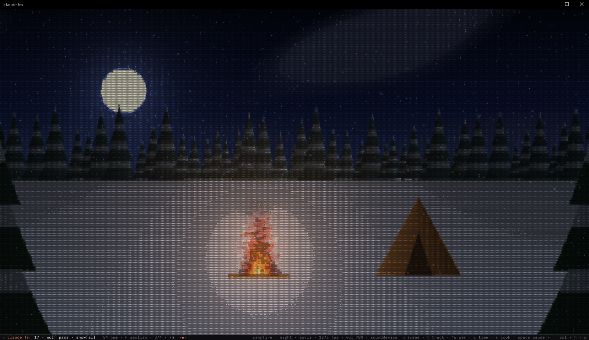

# claude fm

A generative lo-fi radio with animated ASCII landscapes. Every note is composed and synthesised live, nothing
is streamed or sampled. The picture is drawn on the GPU and listens to the music: the firelight breathes with
the bass, sparks fly when the fire crackles, clouds part on chord changes.



claude fm runs on [kor](https://github.com/Desto2000/Kor), a GPU engine for living 2-D scenes with generative
music that was split out of this project.

## What you hear

Music for a cold night by a fire: dark, slow and low, never the same track twice. Each track picks a style and
a few instrument colours, writes itself section by section, and gets its own weather.

| style | sound |
| --- | --- |
| by the fire | tagelharpa or hurdy-gurdy, plucked lyre embers, willow flute |
| snowfall | solo cello, flute, contrabass clarinet |
| alone | morin khuur, throat singing (khöömei), serpent |
| drum circle | locked drum layers (frame drums, shaman drum, rattles, darbuka, taiko), often with a Japanese, Korean, Chinese or Indian percussion palette on top |
| war (Ctrl+W) | a battle: string drive, war drums (beopgo, odaiko, davul), men's choir, throat singers; off the radio until you ask for it |

Under all of it sits a deep bowed low end (octobass, double basses, low reeds). Around 30 instruments are
synthesised from spectra and played by small ensembles (string sections, choir, brass), then placed in instrument
bodies and a mountain-valley reverb. Storm tracks howl; calm nights sometimes get a distant wolf.

## What you see

The rotation is a fire high on a snowy mountain (peaks, the Milky Way, drifting clouds, snow or blizzard) and a
campfire camp at night. War replaces them with a battlefield: riders at the gallop, arrow volleys on the beats,
catapult shots on chord changes. More landscapes (seaside, lighthouse, mountains, a lake, a forest through the
seasons) are in the code but not in the rotation.

Three looks, switched with `r`: **ascii** (glyphs picked by shape inside each cell), **blocks** (`▀`, two colours
per cell) and **braille** (dithered dots).

## Requirements

- An NVIDIA GPU with a current driver. Without CUDA, Warp falls back to the CPU: it runs, but slowly.
- [uv](https://docs.astral.sh/uv/). It installs Python and everything else into the project's `.venv`.
- Tested on Windows 11 with an RTX 3060 Ti. An earlier version ran on Linux (Warp on the CPU); macOS is untested.
- Audio through sounddevice; without it, the music is piped to `mpv` or `ffplay` if one is installed, otherwise
  the visuals run silently.

## Install and run

claude fm expects kor checked out next to it, in a folder named `kor`:

```
git clone https://github.com/Desto2000/Kor kor
git clone https://github.com/Desto2000/claudefm
cd claudefm
uv sync
uv run python -m claudefm
```

On Windows, `claudefm.cmd` does the last step. The first start compiles the GPU kernels (about ten seconds); later
starts use Warp's kernel cache.

## Keys

| key | |
| --- | --- |
| `n` | next scene |
| `t` | next track |
| `Ctrl+W` | war on / off |
| `c` | recolour: a new variant of the scene (another time of day where the scene has more than night) |
| `r` | look: ascii → blocks → braille |
| `space` | pause |
| `↑` `↓` | volume |
| `f` | fullscreen |
| `h` | hide the status bar |
| `q`, `Esc` | quit |

## Options

```
uv run python -m claudefm --canvas 2560x1440 --cell 6x12   # render size and character cell (default 3840x2160, 8x16)
uv run python -m claudefm --look braille --volume 50 --seed 7
uv run python -m claudefm --war                            # start at war
uv run python -m claudefm --vsync                          # cap at the display's refresh rate
uv run python -m claudefm --silent                         # visuals only
uv run python -m claudefm --bench 120                      # time every scene and look on your GPU, no window
uv run python -m claudefm --render out.wav --minutes 3     # music only, to a file (--style war, hearth, ritual …)
```

The canvas is fixed; the window only scales it, with an exact box filter. On an RTX 3060 Ti a 4K canvas takes
0.5–0.9 ms per frame, so the window runs at well over 1,000 fps uncapped. Use `--vsync` to save power.

## Tools

| | |
| --- | --- |
| `tools/preview.py --out clip.mp4 --weather storm` | a 1080p video of a scene with its music |
| `tools/story.py --out story.mp4 --poster cover.png` | a vertical 20 s story: the campfire framed by live data from the music engine |
| `tools/solo.py ab/solo` | solo passages of single instruments through the real mix |
| `tools/drumcircle.py` | one drum-circle clip per percussion palette |
| `tools/launch_trace.py record dir/` · `compare a/ b/` | prove a refactor changed nothing the GPU sees |
| `themes/make_themes.py` | three hand-scored standalone pieces (prehistoric, medieval, modern) |

Run them with `uv run python <tool>`. The video tools use ffmpeg from the `imageio-ffmpeg` dev dependency.

## Layout

```
claudefm/
  scenes.py       the landscapes: host-side setup and small simulations (particles, the boat, the battlefield)
  gpu_scenes.py   their kernels and GPU wrappers
  show.py         which scene plays when, dissolves, the music-driven context, the status bar
  app.py          the window, --bench, --render
tools/            videos, audio clips, refactor checks
themes/           standalone pieces made with the music engine
```

The engine (music, audio output, the frame pipeline, effect kernels, the window) is in kor.
`CLAUDE.md` holds the detailed development notes and measurements.
